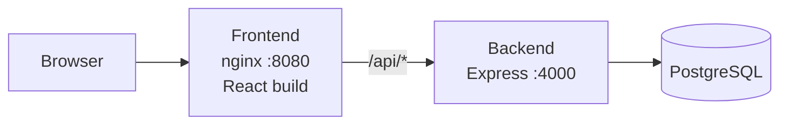

# Store Ratings

A full-stack web app where users rate registered stores from 1 to 5. One login serves three roles, and each role sees different features.

**Stack:** Node.js + Express · PostgreSQL · React (Vite) · Docker Compose · GitHub Actions

---

## Features

| Role | What they can do |
|---|---|
| **System Administrator** | Dashboard with total users, stores and ratings. Add users (any role) and stores. View, filter and sort lists of users and stores. Open any user's details (store owners also show their store's rating). |
| **Normal User** | Sign up and log in. Browse and search stores by name or address. See each store's overall rating and their own rating. Submit or change a rating (1 to 5). Change password. |
| **Store Owner** | Log in. See their store's average rating and the list of users who rated it. Change password. |

All roles can log out. Every table supports ascending/descending sorting, and filters run on the server.

### Validation rules

| Field | Rule |
|---|---|
| Name | 20 to 60 characters |
| Address | Maximum 400 characters |
| Password | 8 to 16 characters, at least one uppercase letter and one special character |
| Email | Standard email format |
| Rating | Whole number from 1 to 5 |

Rules are checked in the browser and enforced again on the API. Store names are limited to 60 characters; the 20-character minimum applies to user names.

---

## Architecture



nginx serves the React build and proxies `/api` to the backend, so the app is same-origin and needs no CORS. Only port 8080 is exposed to the host. The database and the API sit on internal Docker networks.

### Database schema

- `users` (id, name, email unique, address, password_hash, role `ADMIN | USER | OWNER`, created_at)
- `stores` (id, name, email unique, address, owner_id unique → users, created_at)
- `ratings` (id, user_id → users, store_id → stores, rating 1 to 5, updated_at), with a unique pair `(user_id, store_id)` so each user has one rating per store

The schema is in `backend/schema.sql`. Tables and the first admin account are created automatically when the backend starts.

---

## Quick start (Docker)

**Requirements:** Docker with the Compose plugin.

```bash
git clone https://github.com/YOUR_USERNAME/YOUR_REPO.git
cd YOUR_REPO

cp .env.example .env        # Windows: copy .env.example .env
```

Edit `.env`:

| Variable | Notes |
|---|---|
| `DB_USER` | Database user, for example `storeapp` |
| `DB_PASSWORD` | Letters and digits only (it is placed in a connection URL) |
| `JWT_SECRET` | 32 or more random characters, for example `openssl rand -hex 32` |
| `ADMIN_EMAIL` | Email of the first admin account |
| `ADMIN_PASSWORD` | 8 to 16 characters, one uppercase letter, one special character |

Start everything:

```bash
docker compose up --build -d
docker compose ps           # wait until db and backend are "healthy"
```

Open **http://localhost:8080** and sign in with `ADMIN_EMAIL` / `ADMIN_PASSWORD`.

> `ADMIN_PASSWORD` is only used when the admin account is first created. To change it later, use the in-app **Password** button.

Useful commands:

```bash
docker compose logs -f backend    # follow backend logs
docker compose down               # stop, keep data
docker compose down -v            # stop and DELETE the database volume
```

---

## Local development (without Docker)

**Requirements:** Node.js 18+ and PostgreSQL 14+.

1. Create an empty database:
   ```bash
   psql -U postgres -c "CREATE DATABASE store_ratings;"
   ```
2. Backend:
   ```bash
   cd backend
   cp .env.example .env      # set DATABASE_URL and JWT_SECRET (32+ chars)
   npm install
   npm run dev               # http://localhost:4000, creates tables + admin on start
   ```
3. Frontend (second terminal):
   ```bash
   cd frontend
   npm install
   npm run dev               # http://localhost:5173, proxies /api to :4000
   ```

`backend/.env` variables: `DATABASE_URL`, `JWT_SECRET`, `PORT`, `ADMIN_EMAIL`, `ADMIN_PASSWORD`, and optionally `CORS_ORIGIN` (comma-separated origins, only needed if the frontend is hosted on a different origin).

The tables and admin can also be created without starting the server: `npm run db:init`.

---

## Trying it out

1. Sign in as the admin.
2. **Add user:** create a store owner (name of at least 20 characters).
3. **Add store:** create a store and pick that owner.
4. Sign out, then **Create account** to register a normal user.
5. As the normal user, search for the store and rate it. Change the rating to confirm updates.
6. Sign in as the owner to see the average and the list of raters.
7. Sign in as the admin again to see the dashboard counts, filters and sorting.

---

## API reference

All endpoints are under `/api`. Protected routes need `Authorization: Bearer <token>`.

| Method | Path | Role | Purpose |
|---|---|---|---|
| GET | `/health` | none | Health check (database reachable) |
| POST | `/auth/signup` | none | Register a normal user |
| POST | `/auth/login` | none | Returns a token and the user |
| PUT | `/auth/password` | any | Change own password |
| GET | `/admin/stats` | admin | Totals for users, stores, ratings |
| POST | `/admin/users` | admin | Create a user with any role |
| GET | `/admin/users` | admin | List users. Query: `name`, `email`, `address`, `role`, `sort`, `order` |
| GET | `/admin/users/:id` | admin | User details (store owners include their rating) |
| POST | `/admin/stores` | admin | Create a store, optional `ownerId` |
| GET | `/admin/stores` | admin | List stores. Query: `name`, `email`, `address`, `sort`, `order` |
| GET | `/stores` | user | Stores with overall and own rating. Query: `search`, `sort`, `order` |
| PUT | `/stores/:id/rating` | user | Submit or update a rating `{ "rating": 1-5 }` |
| GET | `/owner/dashboard` | owner | Store average and the users who rated it |

Errors return JSON like `{ "message": "..." }`.

---

## Security

- Passwords hashed with bcrypt. JWT access tokens expire after 8 hours. The server refuses to start with a `JWT_SECRET` shorter than 32 characters.
- Role checks on every protected route. Sort columns are whitelisted and all filters use parameterised queries.
- `helmet` headers, a global rate limit, a stricter limit on login, signup and password change, plus an nginx limit on login attempts. Request bodies are capped at 10 KB.
- Login response time does not reveal whether an email exists.
- Containers run as non-root with read-only filesystems, all Linux capabilities dropped, `no-new-privileges`, and memory/process limits. The database has no published port and sits on an internal network.
- nginx sends security headers (CSP, no framing, no content sniffing).

**Before exposing this publicly:** put HTTPS in front of port 8080 (Caddy, Cloudflare or a cloud load balancer), pin base images by digest, scan images (`docker scout cves` or `trivy image`), and schedule database backups.

---

## Tests and CI

```bash
cd backend
npm test
```

The unit tests cover the validation rules, the rating range and the sort/filter query builder. GitHub Actions (`.github/workflows/ci.yml`) runs the backend tests and a dependency audit, and builds the frontend, on every push and pull request.

---

## Backup and restore

```bash
# backup
docker compose exec -T db sh -c 'pg_dump -U "$POSTGRES_USER" store_ratings' | gzip > backup-$(date +%F).sql.gz

# restore
gunzip -c backup-YYYY-MM-DD.sql.gz | docker compose exec -T db sh -c 'psql -U "$POSTGRES_USER" store_ratings'
```

---

## Project structure

```
.
├── .github/workflows/ci.yml
├── .env.example               # Docker settings
├── docker-compose.yml
├── backend/
│   ├── .env.example           # settings for running without Docker
│   ├── Dockerfile
│   ├── schema.sql
│   ├── package.json
│   ├── src/                   # app.js, server.js, initdb.js, db.js, query.js, validators.js
│   └── tests/
└── frontend/
    ├── Dockerfile
    ├── nginx.conf
    ├── package.json
    ├── vite.config.js
    ├── index.html
    └── src/                   # main.jsx, App.jsx, api.js, styles.css
```

---

## Troubleshooting

| Problem | Likely fix |
|---|---|
| Compose says a variable is missing | Fill in `.env` (`DB_PASSWORD`, `JWT_SECRET`, `ADMIN_PASSWORD`). |
| `password authentication failed` | The database volume was created with a different password. `docker compose down -v` (deletes data), then start again. |
| Backend keeps restarting | Check `docker compose logs backend`. |
| `npm ci` fails during build | Run `npm install` in `backend` and `frontend`, and commit both `package-lock.json` files. |
| Login says "Too many attempts" | The rate limiter triggered. Wait a minute and retry. |
| Port 8080 or 4000 already in use | Stop the other process, or change the published port in `docker-compose.yml`. |

---

## License

Add a license of your choice (for example MIT) before publishing.
